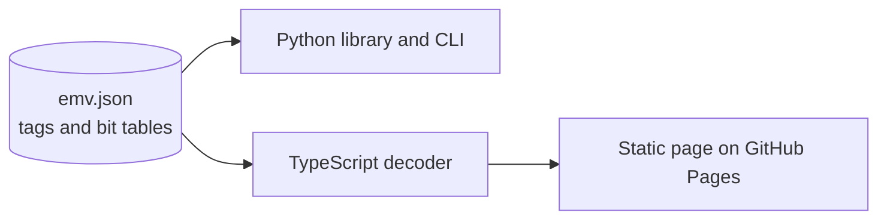

# emv-tlv-lab

[](https://github.com/dobdaniel1/emv-tlv-lab/actions/workflows/ci.yml)


Decode EMV chip card data and explain what it means.

When a chip or contactless transaction is declined, goes online unexpectedly, or fails certification, the reason is usually in the EMV data: the TVR says which check failed, the CID says what the card decided, the CVM results say how the cardholder was verified. This lab turns that hex into plain language.

**Try it in the browser:** https://dobdaniel1.github.io/emv-tlv-lab/ (decoding runs locally, nothing is uploaded)

## Features

- BER-TLV parser: multi-byte tags, constructed templates, long length forms, padding
- Dictionary of 58 common EMV tags
- Explains TVR (95), TSI (9B), AIP (82), CVM List (8E), CVM Results (9F34), CID (9F27) and DOLs (PDOL, CDOL1, CDOL2)
- Masks PAN, track 2 equivalent data and cardholder name by default
- Python library and CLI, plus a TypeScript web page, both driven by one [emv.json](python/src/emv_tlv/emv.json)

## CLI

```bash
cd python
pip install -e ".[dev]"
```

```console
$ emv-tlv decode 9F270180950500000080009F3403420300820239008E0C000000000000271042031F00
9F27 Cryptogram Information Data [1] 80
    - Cryptogram: ARQC (go online)
95 Terminal Verification Results (TVR) [5] 0000008000
    - Transaction exceeds floor limit
9F34 CVM Results [3] 420300
    - Method: Enciphered PIN verified online
    - Condition: If terminal supports the CVM
    - Result: Unknown
82 Application Interchange Profile (AIP) [2] 3900
    - DDA supported
    - Cardholder verification is supported
    - Terminal risk management is to be performed
    - CDA supported
8E CVM List [12] 000000000000271042031F00
    - Amount X: 0
    - Amount Y: 10000
    - Rule 1: Enciphered PIN verified online | If terminal supports the CVM | on failure: next rule
    - Rule 2: No CVM required | Always | on failure: fail

$ emv-tlv tvr 8000048000
Offline data authentication was not performed
Online PIN entered
Transaction exceeds floor limit
```

Shortcuts: `tvr`, `tsi`, `aip`, `cvm`, `cid`, `cvmlist`.

## Library

```python
from emv_tlv import parse, find, decode_tvr

items = parse(field_55_hex)
tvr = find(items, "95")
print(decode_tvr(tvr.value))
```

## Design



One data file holds tag names and bit meanings. The Python package loads it at runtime; the web page bundles it with esbuild. Adding a tag or fixing a bit description updates both.

## Testing

| Part | Tools | What is covered |
|---|---|---|
| Python | pytest, Hypothesis | Parser edge cases, malformed input, encode and parse round trips, every decoder, masking, CLI |
| Web | node:test, tsc strict | Same parser and decoder cases, row rendering and masking |
| CI | GitHub Actions | Python 3.10 to 3.13, typecheck, tests, build, Pages deploy |

All sample data uses public test values.

## Scope

Bit meanings follow EMV Book 3 (version 4.3). Contactless kernels and card schemes define extra tags and bits; these show as `Unknown tag` or `RFU` and can be added to `emv.json`.

## License

MIT
